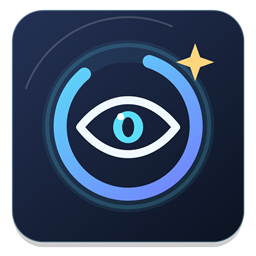
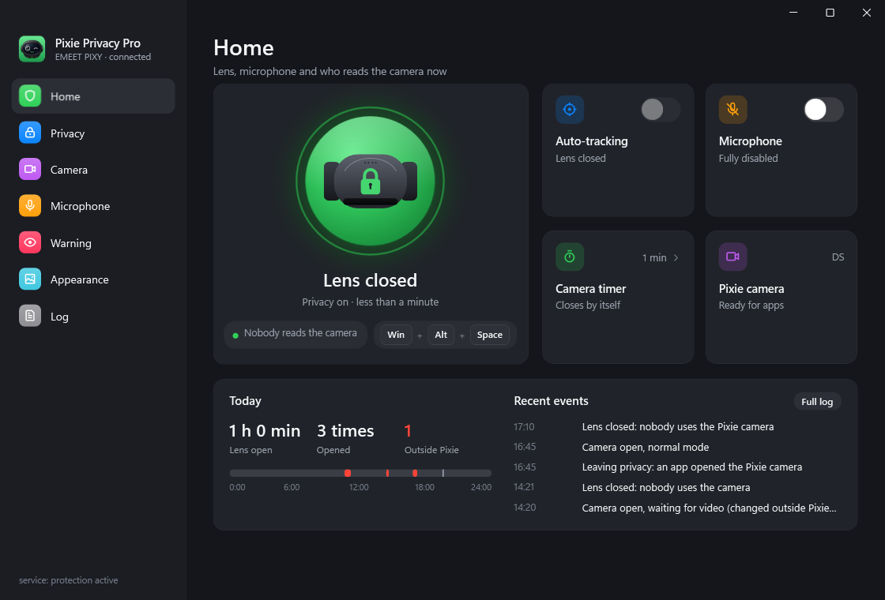
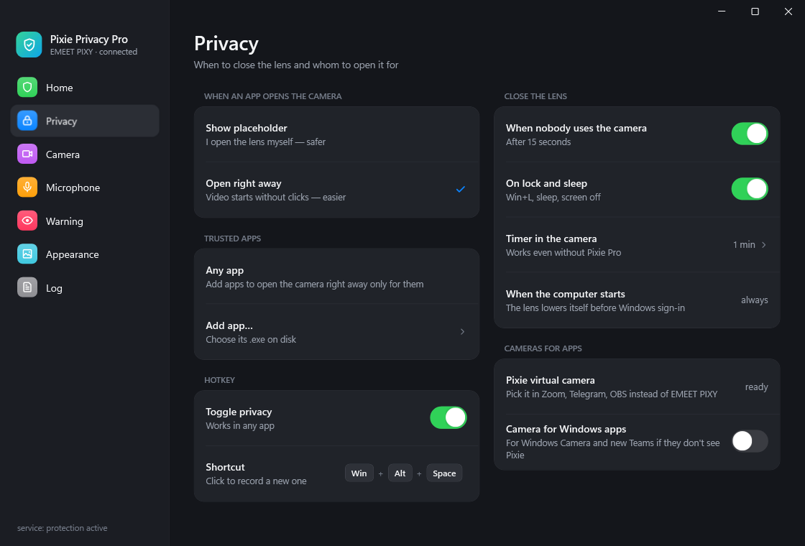
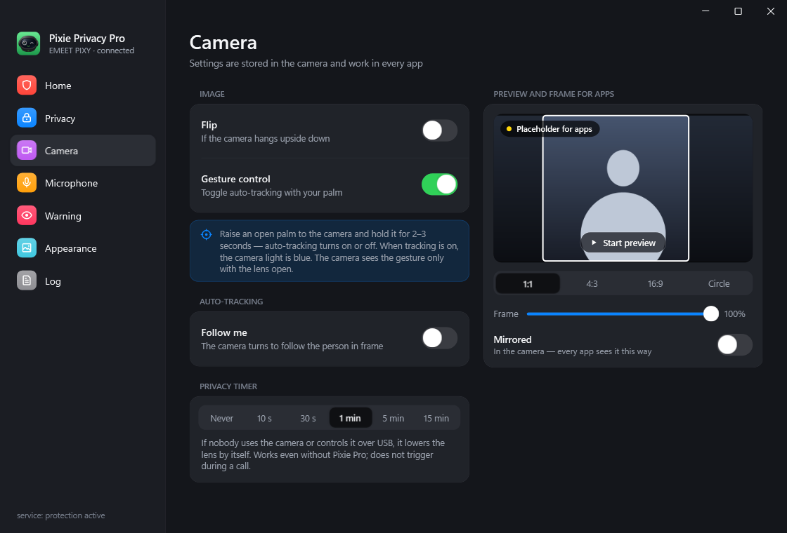
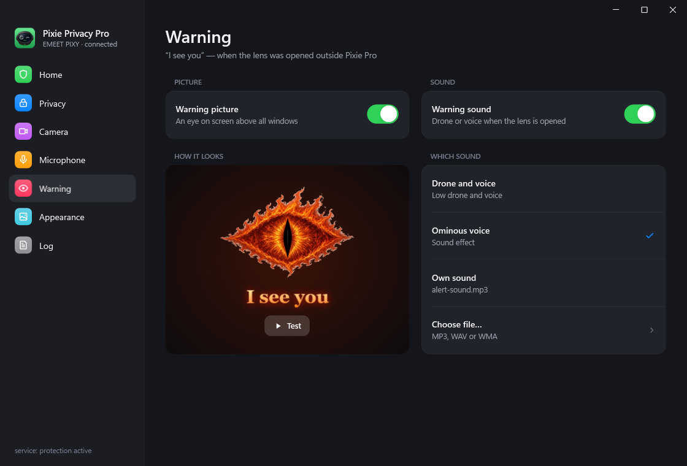
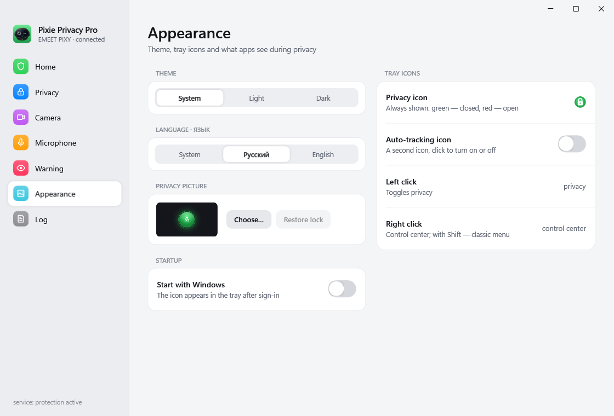
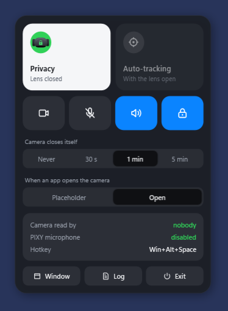
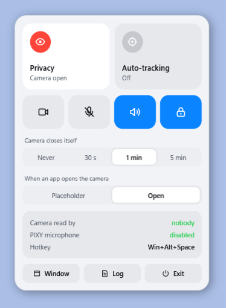

<div align="center">



# Pixie Privacy Pro

**Privacy control for the EMEET PIXY webcam on Windows: a privacy switch in the tray, a virtual camera that never shows you by surprise, and a loud warning when the lens opens behind your back.**

[](https://github.com/Gamchikot/PixiePrivacyPro/releases/latest)
[](https://github.com/Gamchikot/PixiePrivacyPro/releases)
[](https://github.com/Gamchikot/PixiePrivacyPro/actions/workflows/build.yml)
[](LICENSE)


**English** · [Русский](README.ru.md)



</div>

> [!NOTE]
> Unofficial software. Not affiliated with or endorsed by EMEET. EMEET and PIXY are trademarks of their owners.
> EMEET Studio is not needed.

## Why

The PIXY has a real privacy mode: the lens physically turns away. But nothing tells you when an app turns it back,
apps open it the moment they touch the camera, and the microphone is always there. Pixie Privacy Pro keeps the lens
closed until **you** open it, warns you if anything else does, and shows you who is using the camera and microphone.

## Features

| | |
|---|---|
| 🔒 **One-click privacy** | Big orb in the window, a tray icon (green lock / red eye), a tray control center and a global hotkey (Win+Alt+Space by default). |
| 🎥 **Pixie virtual camera** | Pick *Pixie Privacy Pro Camera* in Zoom, Telegram, OBS, Teams. While the lens is closed, apps see a lock picture (or your own picture) instead of you. A Media Foundation camera is added for the Windows Camera app and the new Teams. |
| 🤝 **You decide who opens the lens** | *Show placeholder* — you open the lens yourself. *Open right away* — the lens rises when an app starts reading; limit it to trusted apps. |
| 👁 **"I see you" warning** | If the lens opens outside Pixie Pro, a burning eye appears over all windows with a sound of your choice. Picture and sound switch on separately. |
| 🎙 **Microphone off for real** | A small service disables only the PIXY recording device in Windows — not muted, gone — and keeps it off until you, or a program running as you, turn it back on. Or turn it on with noise reduction, live sound or no processing. |
| ⏱ **Closes by itself** | When nobody uses the camera, on Win+L, sleep and screen off, and by the camera's own timer — even when Pixie Pro is not running. The lens is lowered at power-on, before you sign in. |
| 🖼 **Frame and mirror** | Preview with 1:1, 4:3, 16:9 and circle frames; only the chosen part goes to apps. Mirror, flip and gesture control are stored in the camera itself. |
| 📊 **Journal** | Today's open time, openings and openings outside Pixie Pro, and a searchable log of who used the camera and microphone. |
| 🌗 **Native look** | Windows 11 style, light and dark themes, English and Russian. |

<table>
<tr>
<td></td>
<td></td>
</tr>
<tr>
<td></td>
<td></td>
</tr>
</table>

<p align="center">

&nbsp;

</p>

## Install

1. Download **`PixiePrivacyPro-Setup-<version>.msi`** from [Releases](https://github.com/Gamchikot/PixiePrivacyPro/releases/latest).
2. Run it. The installer speaks your Windows language (Russian for Russian and some CIS Windows, English otherwise).
   Administrator rights are needed for the microphone service and the virtual camera.
3. Windows SmartScreen may say *"Windows protected your PC"* because the installer is not code-signed yet:
   click **More info → Run anyway**. Compare the file's SHA-256 with `SHA256-<version>.json` from the release if you want to be sure.
4. Start **Pixie Privacy Pro** from the Start menu. It lives in the tray; left click toggles privacy, right click opens the control center.

Requirements: Windows 10 or 11 x64, .NET Framework 4.8 (built into Windows), an EMEET PIXY. Close EMEET Studio: only one program can control the camera.

## Use it in an app

Choose **Pixie Privacy Pro Camera** as the camera in your app (or *Pixie Privacy Pro Camera (MF)* for the Windows Camera app).
Video flows by itself while the app reads the camera. Keep Pixie Pro running — the tray icon is enough.

## How it works

- Privacy mode, the camera timer, gestures, mirror and flip are the PIXY's own settings, sent over USB HID (the same commands EMEET Studio uses).
- The virtual camera is the unmodified [Unity Capture](https://github.com/schellingb/UnityCapture) DirectShow filter plus a small Media Foundation source (`native/PixieVCam.cpp`). Pixie Pro captures the PIXY only while an app reads the virtual camera or the preview is open.
- Who uses the camera and microphone comes from Windows' own privacy records (CapabilityAccessManager).
- The microphone service (`PixiePrivacyProMicGuard`) disables only the PIXY audio interface (VID 328F, PID 00C0, MI_02). Other microphones are never touched.
- Everything runs locally. No network, no telemetry, no video written to disk.

Every feature in detail: [docs/DETAILS.md](docs/DETAILS.md).

## Build from source

```powershell
# Tools: .NET Framework 4.8 compiler (in Windows), llvm-mingw (ucrt, x86_64), WiX Toolset 3.14 for the installer.
$env:LLVM_MINGW = 'C:\tools\llvm-mingw-20261006-ucrt-x86_64'
$env:WIX = 'C:\tools\wix314'
.\build.ps1 -Test   # app, service and camera into bin\, then the offline tests
.\package.ps1       # dist\PixiePrivacyPro-Setup-<version>.msi and its SHA-256
```

`tests\bin\UiShots.exe [folder] [--en]` renders every screen to PNG without a camera. Tests named `Tests`, `TrackingCheck`,
`TrackingUiCheck`, `CameraCli` and `PixyProbe` need a connected PIXY; `MfCameraCheck` needs the installed MSI.
The version comes from `version.txt`. GitHub Actions builds every push and makes a draft release for every `v*` tag.

## FAQ

**Does the green lock mean nobody can see me?** It means the PIXY reports privacy mode and the lens is turned away. Software can ask the camera to leave privacy — that is exactly what the warning is for.

**An app shows a black picture.** Make sure Pixie Pro is running and the app uses *Pixie Privacy Pro Camera*. Some apps don't list DirectShow cameras — try the *(MF)* camera.

**Can I use my own picture or sound?** Yes: *Appearance → Privacy picture* and *Warning → Which sound → Choose file*.

**Is the microphone muted or disabled?** Disabled in Windows by a service, so apps cannot record from it. It stays off until you, or a program running under your account, turn it back on: it is a software switch, not a hardware one.

## Code signing

Releases are not code-signed, so Windows SmartScreen may show an "unknown publisher" warning. Every MSI is built by
[GitHub Actions](.github/workflows/build.yml) from this repository; compare its SHA-256 with the one published in the release.

## Privacy

This program will not transfer any information to other networked systems unless specifically requested by the user or
the person installing or operating it. It reads Windows' camera and microphone usage records and writes its journal and
settings only on this computer (`%LOCALAPPDATA%\PixiePrivacyPro`, `HKCU\Software\PixiePrivacyPro`). The installer adds a virtual
camera and a service that disables the PIXY microphone; uninstalling the program removes both (a microphone that was disabled stays off until you turn it on in Windows sound settings).

## Contributing

Bug reports and ideas are welcome — see [CONTRIBUTING.md](CONTRIBUTING.md). Security issues: [SECURITY.md](SECURITY.md).

## License

[GPL-3.0-or-later](LICENSE). Third-party parts keep their licenses: [HIDAPI](https://github.com/libusb/hidapi) (BSD),
[AForge.NET](https://github.com/andrewkirillov/AForge.NET) 2.2.5 (LGPL v3, source included in `third_party/`),
[Unity Capture](https://github.com/schellingb/UnityCapture) (MIT). PIXY commands: thanks to
[omarchy-emeet-pixy](https://github.com/nille/omarchy-emeet-pixy/blob/main/docs/PROTOCOL.md).
