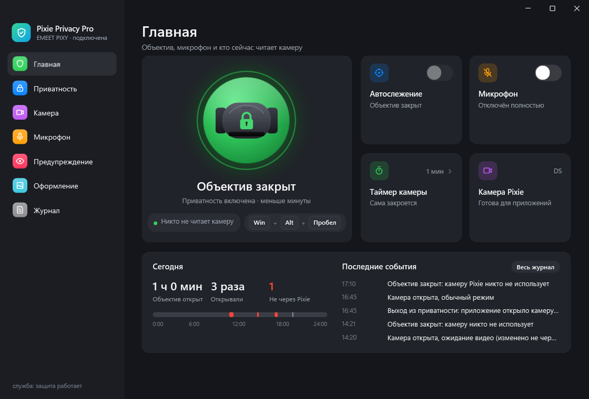
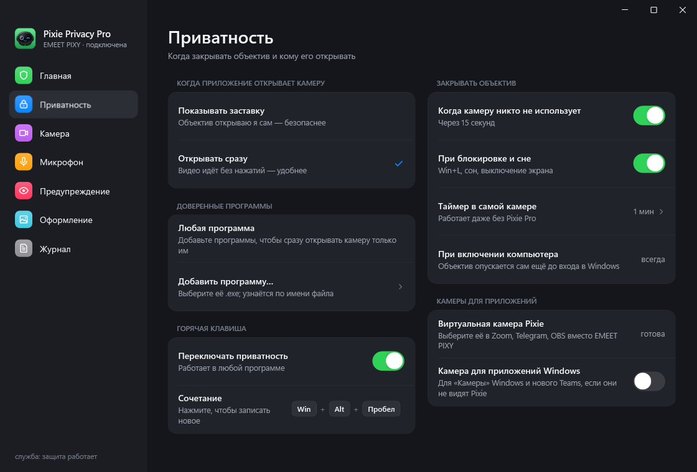
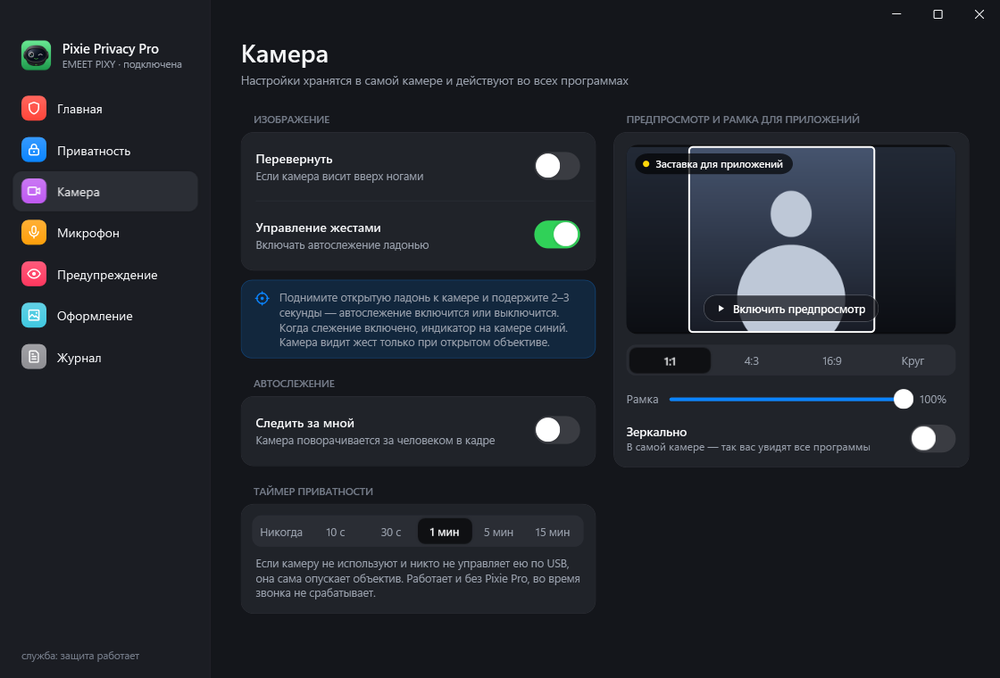
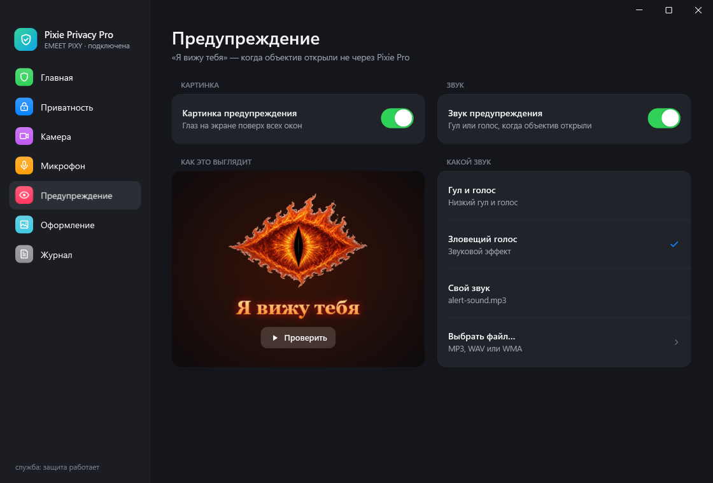
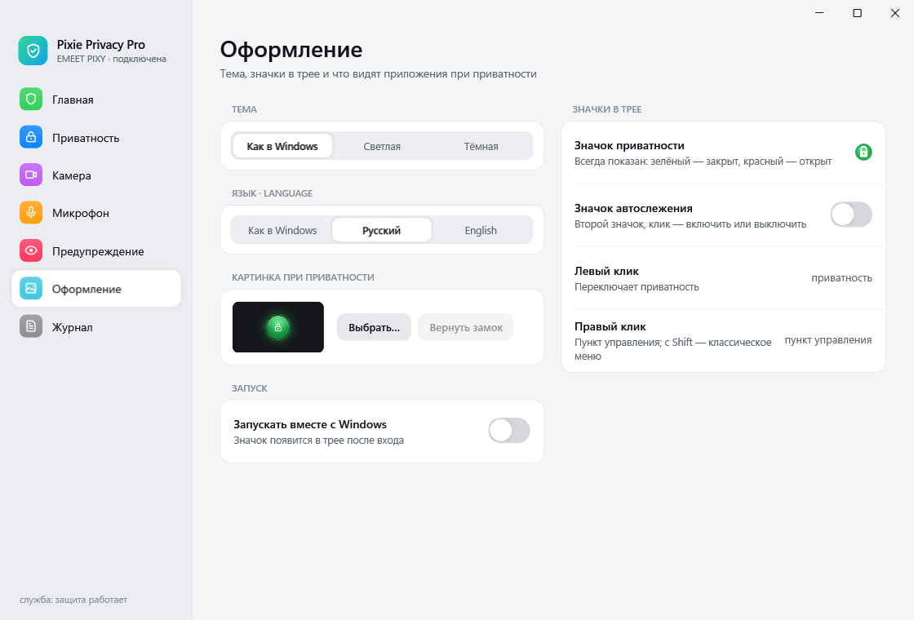
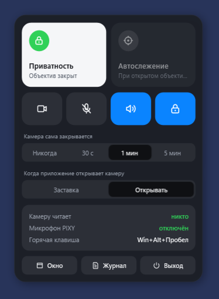
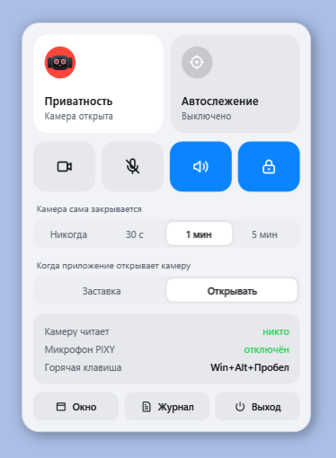

<div align="center">


# Pixie Privacy Pro

**Приватность для веб-камеры EMEET PIXY в Windows: переключатель в трее, виртуальная камера, которая никогда не покажет вас без спроса, и громкое предупреждение, если объектив открыли за вашей спиной.**

[](https://github.com/Gamchikot/PixiePrivacyPro/releases/latest)
[](https://github.com/Gamchikot/PixiePrivacyPro/releases)
[](https://github.com/Gamchikot/PixiePrivacyPro/actions/workflows/build.yml)
[](LICENSE)


[English](README.md) · **Русский**



</div>

> [!NOTE]
> Неофициальная программа. Не связана с EMEET и не одобрена ею. EMEET и PIXY — товарные знаки их владельцев.
> EMEET Studio не нужна.

## Зачем

У PIXY есть настоящий режим приватности: объектив физически отворачивается. Но никто не скажет вам, если программа
развернёт его обратно, приложения открывают его, как только обращаются к камере, а микрофон включён всегда.
Pixie Privacy Pro держит объектив закрытым, пока его не откроете **вы**, показывает, кто пользуется камерой и микрофоном,
и заставляет камеру слушаться только вас.

## Возможности

| | |
|---|---|
| 🔒 **Приватность в один клик** | Большой шар в окне, значок в трее (зелёный замок / красный глаз), пункт управления у трея и горячая клавиша (по умолчанию Win+Alt+Пробел). |
| 🎥 **Виртуальная камера Pixie** | Выберите *Pixie Privacy Pro Camera* в Zoom, Telegram, OBS, Teams. Пока объектив закрыт, программы видят замок (или вашу картинку), а не вас. Для «Камеры» Windows и нового Teams есть ещё камера Media Foundation. |
| 🤝 **Вы решаете, кто откроет объектив** | «Показывать заставку» — объектив открываете вы сами. «Открывать сразу» — объектив поднимается, когда программа начинает читать камеру; можно разрешить это только доверенным программам. |
| 👁 **Предупреждение «Я вижу тебя»** | Если объектив открыли не через Pixie Pro, поверх всех окон появляется огненный глаз со звуком на ваш выбор. Картинка и звук включаются отдельно. |
| 🎙 **Микрофон выключен по-настоящему** | Небольшая служба отключает в Windows только устройство записи PIXY — не заглушает, а убирает — и следит, чтобы оно оставалось выключенным. Или включите его с шумоподавлением, живым звуком или без обработки. |
| ⏱ **Закрывается сама** | Когда камерой никто не пользуется, при Win+L, сне и выключении экрана и по собственному таймеру камеры — даже без Pixie Pro. При включении компьютера объектив опускается ещё до входа в Windows. |
| 🖼 **Рамка и зеркало** | Предпросмотр с рамками 1:1, 4:3, 16:9 и «Круг»: программы получают только выбранную часть. Зеркало, переворот и жесты хранятся в самой камере. |
| 📊 **Журнал** | Сколько объектив был открыт сегодня, сколько раз его открывали и сколько раз не через Pixie Pro, а также журнал с поиском: кто пользовался камерой и микрофоном. |
| 🌗 **Как родная** | Стиль Windows 11, светлая и тёмная темы, русский и английский языки. |

<table>
<tr>
<td></td>
<td></td>
</tr>
<tr>
<td></td>
<td></td>
</tr>
</table>

<p align="center">

&nbsp;

</p>

## Установка

1. Скачайте **`PixiePrivacyPro-Setup-<версия>.msi`** в разделе [Releases](https://github.com/Gamchikot/PixiePrivacyPro/releases/latest).
2. Запустите. Установщик говорит на языке Windows (русский для русской и ряда Windows СНГ, иначе английский).
   Нужны права администратора: для службы микрофона и виртуальной камеры.
3. Windows SmartScreen может написать «Система Windows защитила ваш компьютер», потому что установщик пока не подписан:
   нажмите **Подробнее → Выполнить в любом случае**. Для уверенности сверьте SHA-256 файла с `SHA256-<версия>.json` из релиза.
4. Запустите **Pixie Privacy Pro** из меню «Пуск». Программа живёт в трее: левый клик переключает приватность, правый открывает пункт управления.

Требования: Windows 10 или 11 x64, .NET Framework 4.8 (уже есть в Windows), EMEET PIXY. Закройте EMEET Studio: управлять камерой может только одна программа.

## Как пользоваться в программах

Выберите камеру **Pixie Privacy Pro Camera** в настройках видео программы (или *Pixie Privacy Pro Camera (MF)* для «Камеры» Windows).
Видео пойдёт само, пока программа читает камеру. Держите Pixie Pro запущенной — достаточно значка в трее.

## Как это устроено

- Режим приватности, таймер камеры, жесты, зеркало и переворот — собственные настройки PIXY, они передаются по USB HID (те же команды, что у EMEET Studio).
- Виртуальная камера — неизменённый фильтр DirectShow [Unity Capture](https://github.com/schellingb/UnityCapture) и небольшой источник Media Foundation (`native/PixieVCam.cpp`). Pixie Pro снимает видео с PIXY только пока программа читает виртуальную камеру или открыт предпросмотр.
- Кто пользуется камерой и микрофоном, берётся из собственного учёта Windows (CapabilityAccessManager).
- Служба микрофона (`PixiePrivacyProMicGuard`) отключает только аудиоинтерфейс PIXY (VID 328F, PID 00C0, MI_02). Другие микрофоны не трогаются.
- Всё работает локально: без сети, без телеметрии, видео на диск не пишется.

Подробное описание всех функций — в [docs/DETAILS.ru.md](docs/DETAILS.ru.md).

## Сборка из исходников

```powershell
# Нужны: компилятор .NET Framework 4.8 (есть в Windows), llvm-mingw (ucrt, x86_64), WiX Toolset 3.14 для установщика.
$env:LLVM_MINGW = 'C:\tools\llvm-mingw-20261006-ucrt-x86_64'
$env:WIX = 'C:\tools\wix314'
.\build.ps1 -Test   # программа, служба и камера в bin\, затем офлайн-тесты
.\package.ps1       # dist\PixiePrivacyPro-Setup-<версия>.msi и его SHA-256
```

`tests\bin\UiShots.exe [папка] [--en]` рисует все экраны в PNG без камеры. Тесты `Tests`, `TrackingCheck`, `TrackingUiCheck`,
`CameraCli` и `PixyProbe` требуют подключённую PIXY; `MfCameraCheck` — установленный MSI. Версия берётся из `version.txt`.
GitHub Actions собирает каждый коммит и создаёт черновик релиза для каждого тега `v*`.

## Вопросы

**Зелёный замок значит, что меня никто не видит?** Он значит, что PIXY сообщает режим приватности и объектив отвёрнут. Программа может попросить камеру выйти из приватности — именно для этого и нужно предупреждение.

**В программе чёрный экран.** Проверьте, что Pixie Pro запущена и в программе выбрана *Pixie Privacy Pro Camera*. Некоторые программы не видят камеры DirectShow — попробуйте камеру *(MF)*.

**Можно поставить свою картинку или звук?** Да: «Оформление → Картинка при приватности» и «Предупреждение → Какой звук → Выбрать файл».

**Микрофон заглушен или отключён?** Отключён в Windows службой, поэтому ни одна программа его не откроет. Это программный выключатель, а не аппаратный.

## Подпись кода

Релизы не подписаны цифровой подписью, поэтому Windows SmartScreen может предупредить о «неизвестном издателе». Каждый MSI
собирается [GitHub Actions](.github/workflows/build.yml) из этого репозитория; сверьте его SHA-256 с указанным в релизе.

## Конфиденциальность

Программа не передаёт никаких данных в другие системы по сети, если пользователь или тот, кто её установил, сам об этом не попросит.
Она читает учёт Windows об использовании камеры и микрофона и хранит журнал и настройки только на этом компьютере
(`%LOCALAPPDATA%\PixiePrivacyPro`, `HKCU\Software\PixiePrivacyPro`). Установщик добавляет виртуальную камеру и службу,
отключающую микрофон PIXY; при удалении программы удаляются обе (отключённый микрофон остаётся выключенным, пока вы не включите его в настройках звука Windows).

## Участие

Сообщения об ошибках и идеи приветствуются — см. [CONTRIBUTING.md](CONTRIBUTING.md). Уязвимости: [SECURITY.md](SECURITY.md).

## Лицензия

[GPL-3.0-or-later](LICENSE). Сторонние части сохраняют свои лицензии: [HIDAPI](https://github.com/libusb/hidapi) (BSD),
[AForge.NET](https://github.com/andrewkirillov/AForge.NET) 2.2.5 (LGPL v3, исходники в `third_party/`),
[Unity Capture](https://github.com/schellingb/UnityCapture) (MIT). Команды PIXY: спасибо
[omarchy-emeet-pixy](https://github.com/nille/omarchy-emeet-pixy/blob/main/docs/PROTOCOL.md).
